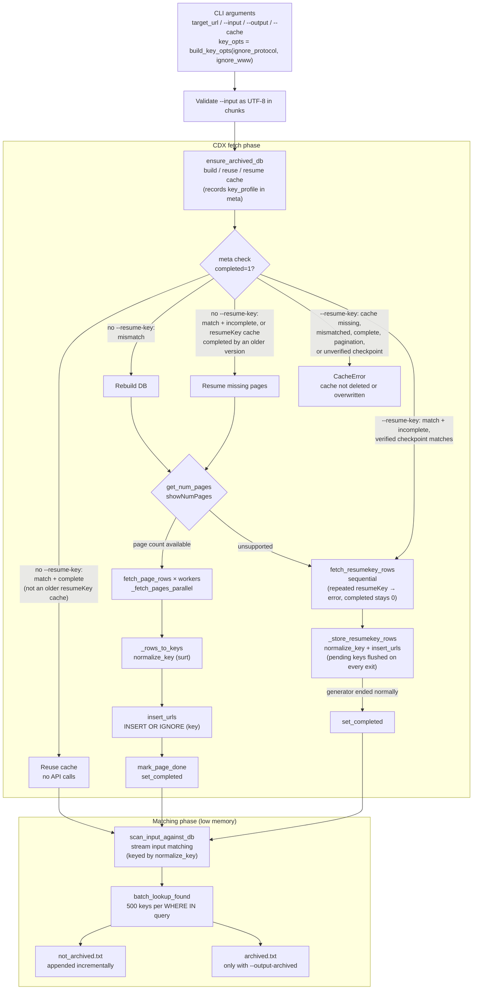

# Wayback Gap Detector — Architecture

## Overview

A CLI tool that compares a local URL list against Wayback Machine CDX API responses to find URLs that have not been archived.
Matching uses [surt](https://github.com/internetarchive/surt) keys, applied with identical settings to both the CDX `original` rows and the local URLs, and compares keys directly.
Only the `original` column is fetched from CDX (`fl=original`).
The cache is a single SQLite `.db` file. Fetching primarily uses pagination in parallel, falling back to sequential resumeKey fetches only when pagination is unavailable.

There are two key modes:

- **lenient (default)**: surt defaults (including `www`/`wwwN` removal, scheme dropping, and query sorting/lowercasing). CDX queries use `collapse=urlkey`.
- **strict** (`--no-ignore-www` / `--no-ignore-protocol`): applies `host_massage=False` / `with_scheme=True`. CDX queries use `collapse=original` (folds only consecutive duplicates of the same `original` spelling; distinct variants are kept).

Page-count queries (`showNumPages`) send the same `pageSize` and `collapse` as page fetches.

## Data flow

## Table design (SQLite)

| Table | Definition | Purpose |
|---|---|---|
| `meta` | `(k TEXT PRIMARY KEY, v TEXT) WITHOUT ROWID` | Run parameters, `key_profile`, `completed` flag, `mode`, `resume_key`, etc. Rebuilt automatically when parameters differ |
| `archived` | `(key TEXT PRIMARY KEY) WITHOUT ROWID` | Set of surt keys only (`original` is not stored) |
| `pages_done` | `(page INTEGER PRIMARY KEY)` | Fetched page numbers. On interruption, only missing pages are fetched again |

## Function reference

### Key generation (surt)

| Function | Description |
|---|---|
| `build_key_opts` | surt options for a run |
| `key_profile` | Stable fingerprint for cache identity (e.g. `surt-default` / `surt:host_massage=False`) |
| `normalize_key` | Converts a URL to a surt key |
| `canonicalize_nodns` | Copy of surt.GoogleURLCanonicalizer.canonicalize. Only `attemptIPFormats()` is replaced with a DNS-free variant (removing `socket.gethostbyname_ex` for numerically shaped hosts). Byte-identical to the default canonicalizer for ordinary hosts |

### CDX API layer

| Function | Description |
|---|---|
| `_pause` | Waits for `seconds`, raising the internal `_FetchCancelled` once `stop` is set |
| `_RateLimiter.wait` | Spaces calls at least `interval` seconds apart across threads. The module-level `_CDX_LIMITER` uses `CDX_REQUEST_INTERVAL` (3.0 s) and is shared by every CDX request |
| `make_session` | Creates a retrying `Session` |
| `_cdx_params` | Builds request parameters shared by both fetch paths |
| `_split_resume_key` | Splits a trailing resumeKey off the raw response |
| `_strip_header` | Removes the header row (`urlkey`/`original`) at the start of a chunk |
| `_get_with_retries` | GET with retries, also detecting empty/non-JSON responses |
| `get_num_pages` | Fetches the total page count via `showNumPages` |
| `fetch_page_rows` | Fetches one page |
| `fetch_resumekey_rows` | Generator for sequential resumeKey fetching. Ends normally only when a response carries no resumeKey. A failed request raises `ResumeKeyRequestError` (a `CDXAPIError` subclass carrying the key of the failed request) |
| `_rows_to_keys` | Converts CDX rows into a list of surt keys |
| `_fetch_pages_parallel` | Fetches the given pages in a thread pool and yields `(page, keys)` as they complete (see [Stopping a pagination fetch](#stopping-a-pagination-fetch)) |

### Orchestration and matching

| Function | Description |
|---|---|
| `ensure_archived_db` | Determines reuse/resume/rebuild (including profile or column-layout mismatches) and builds the DB, returning its path |
| `_store_resumekey_rows` | Inserts the keys of `fetch_resumekey_rows` rows in batches and returns the count. After a failed request (`ResumeKeyRequestError`), the failed request's key is stored in `meta.resume_key` |
| `count_input_lines` | Counts total lines quickly for the `scan_input_against_db` progress bar |
| `scan_input_against_db` | Streams, keys, batch-queries, and incrementally writes the input, returning `(total, not archived, archived)`. A leading UTF-8 BOM in the input is ignored |
| `main` | CLI entry point (argument parsing, `build_key_opts`, DB setup, matching, exit code) |

### Stopping a pagination fetch

When a page fails, the consumer closes the generator, or Ctrl+C arrives,
`_fetch_pages_parallel` stops the remaining work instead of fetching every
queued page:

1. `ex.shutdown(wait=False, cancel_futures=True)` cancels the queued pages,
   so no worker picks up another one. When a failed page completes in the
   same poll as successful ones, steps 1 and 2 run before those pages are
   yielded; they run only once.
2. The shared stop event is set. Workers waiting on the rate limiter or
   between retries wake at once and end with `_FetchCancelled`; a request
   already in progress finishes first (up to about 4 minutes with urllib3
   retries), and its result is discarded.
3. The exception propagates. Pages already stored stay in `pages_done`,
   `completed` stays 0, and the next run fetches only the missing pages.

`ensure_archived_db` needs no extra handling: when an exception leaves its
`for` loop (for example Ctrl+C during `insert_urls`), CPython closes the
generator, which runs the same steps.
